# 🏨 Sphinx Hotel — Hotel Management System

<div align="center">

**A full-featured desktop application for managing hotel operations — reservations, check-ins, orders, inventory, rooms, and staff — built on a clean 3-tier C# architecture.**

[](https://dotnet.microsoft.com/)
[](https://learn.microsoft.com/en-us/dotnet/desktop/winforms/)
[](https://www.microsoft.com/sql-server)
[](https://learn.microsoft.com/en-us/dotnet/framework/data/adonet/)
[](#license)

[Features](#-key-features) • [Screenshots](#-screenshots) • [Architecture](#-architecture) • [Getting Started](#-getting-started) • [Project Structure](#-project-structure)

</div>

---

## 📖 Overview

**Sphinx Hotel** is a robust **desktop hotel management system** built to streamline the day-to-day operations of a hotel — from the moment a guest makes a reservation to the moment they check out. It replaces scattered spreadsheets and manual logs with a single, consistent source of truth for reservations, room status, guest profiles, orders, and billing.

The system was designed with **real hotel workflows** in mind: front-desk staff can create reservations and process check-ins/check-outs in a few clicks, room service and amenities are tracked through an integrated ordering system, and administrators can manage users, rooms, and inventory from dedicated panels — all backed by a relational SQL Server database with stored procedures for data integrity and performance.

## ✨ Key Features

| Module                          | What it does                                                                                                                 |
| ------------------------------- | ---------------------------------------------------------------------------------------------------------------------------- |
| 🧾 **Reservations**             | Create, modify, and cancel reservations; store guest details, stay dates, room preferences, and payment status in one place. |
| 🛎️ **Check-In / Check-Out**     | Process guest arrivals and departures, update room occupancy in real time, and handle booking modifications.                 |
| 🧍 **Guest Profiles**           | Maintain detailed guest records — personal info, contact details, and stay history.                                          |
| 🛏️ **Room Management**          | Track room availability and status live, and assign rooms based on guest preferences and bookings.                           |
| 🧰 **Room Types & Services**    | Define room types by size, amenities, and pricing; manage services like housekeeping, maintenance, and laundry.              |
| 🛒 **Orders & Room Service**    | Place and track orders for dining, room service, and other hotel offerings, with live order status.                          |
| 📦 **Inventory & Items**        | Maintain a catalog of hotel items and supplies — descriptions, prices, and stock levels.                                     |
| 💳 **Payments & Invoicing**     | Securely process payments and generate detailed invoices covering room charges, taxes, and services.                         |
| 👤 **User & Access Management** | Manage staff accounts with encrypted passwords and role-based, secure login.                                                 |

## 🖼️ Screenshots

<div align="center">

### 🔐 Authentication

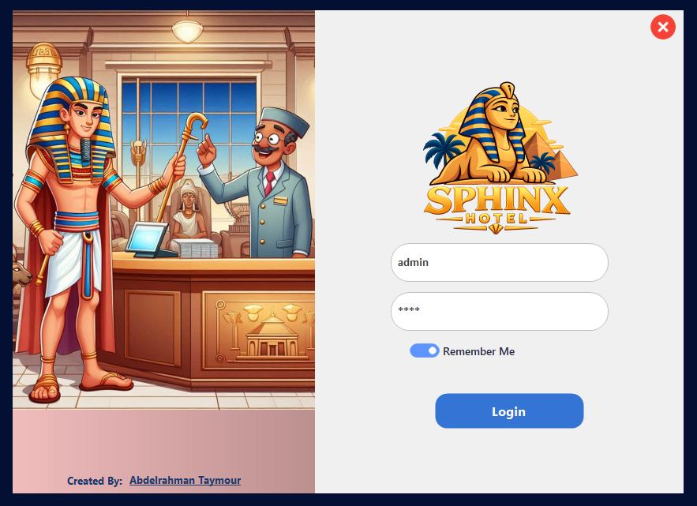

### 🏠 Reservations

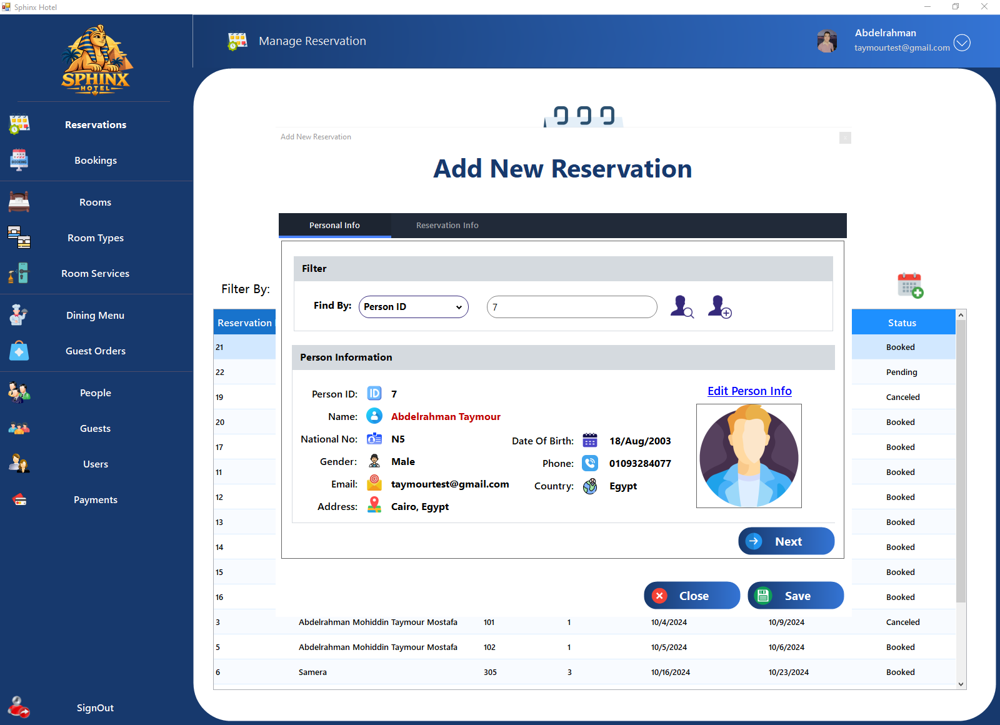
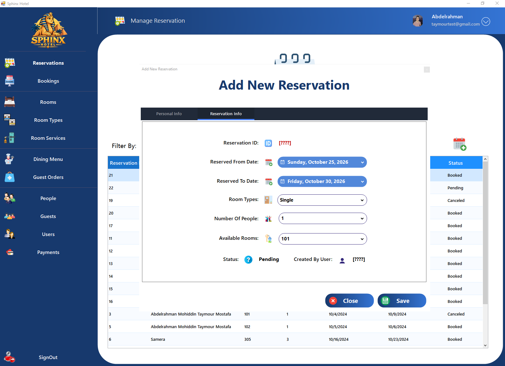

### 🛎️ Check-In / Check-Out

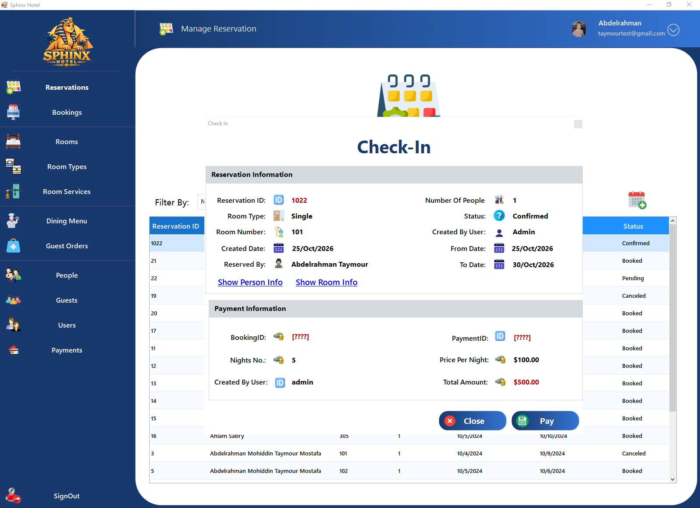
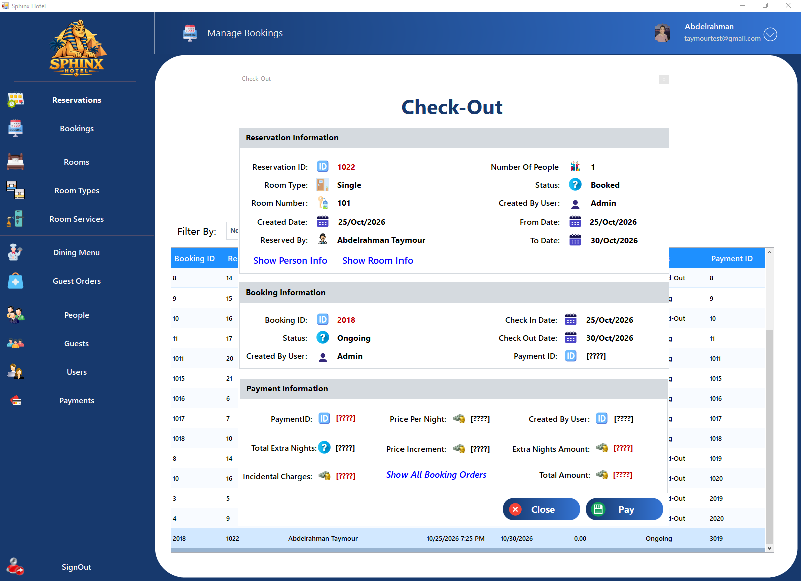

### 🛏️ Rooms

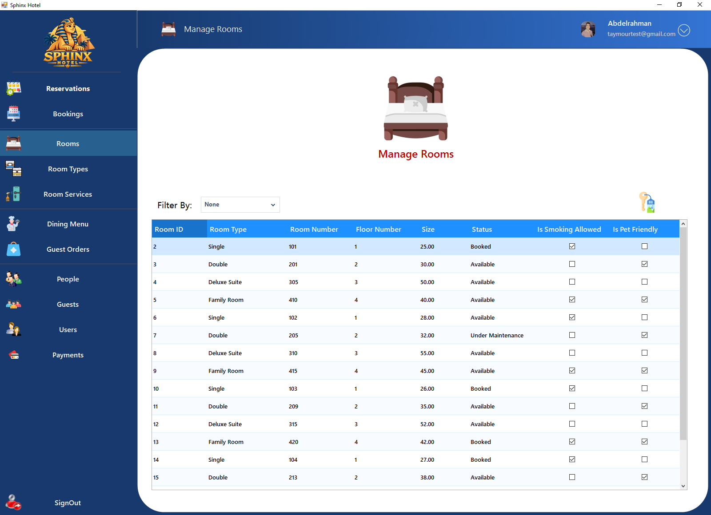
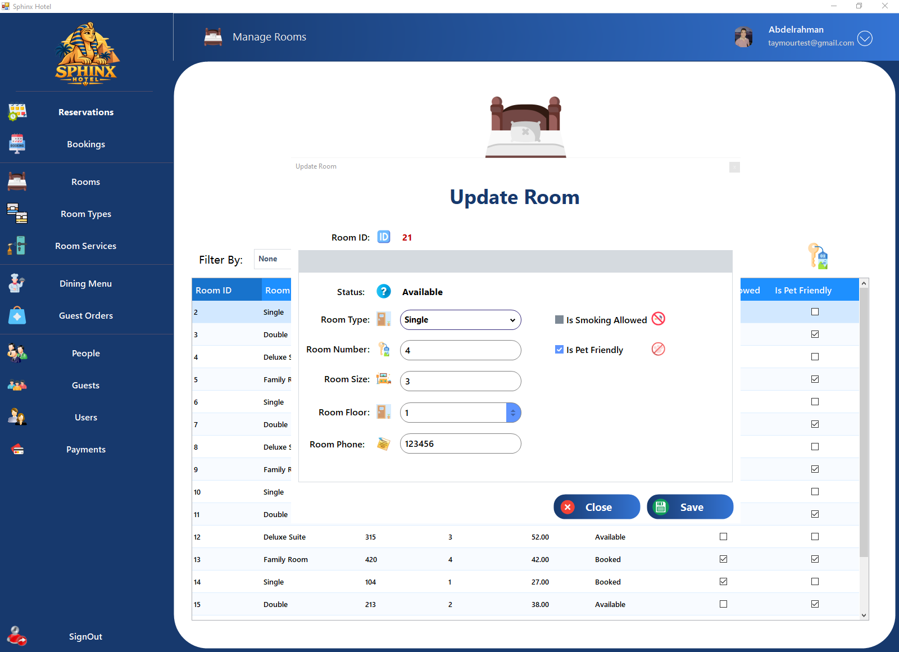

### 🛒 Orders

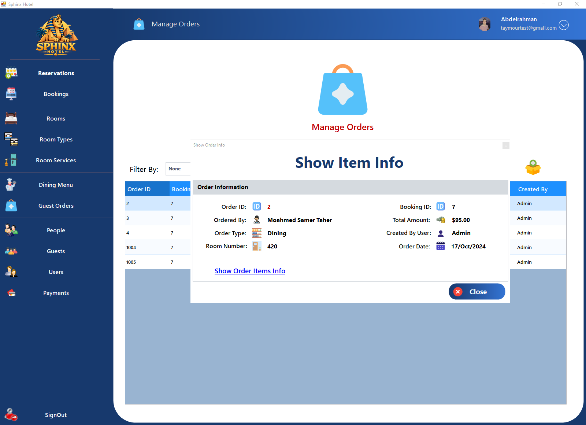
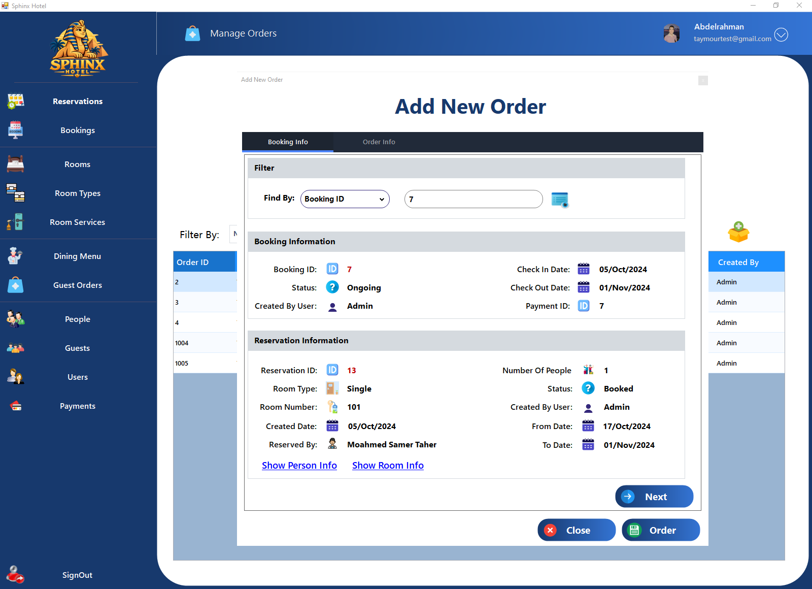
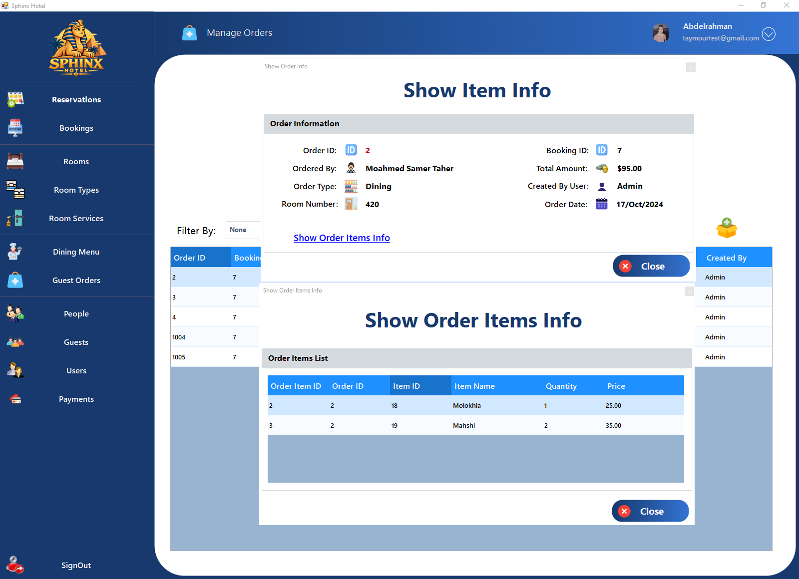
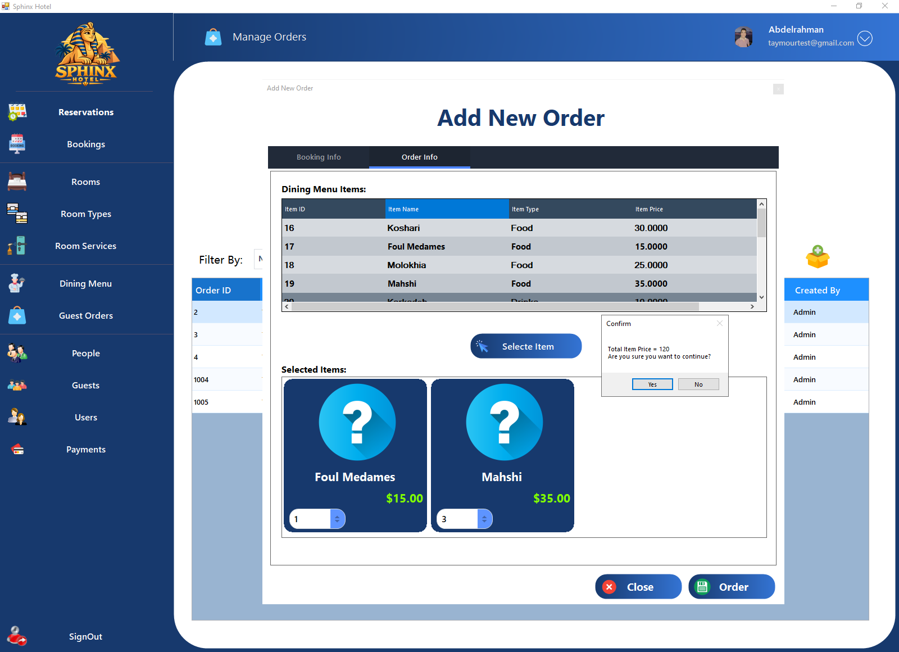

### 📦 Inventory

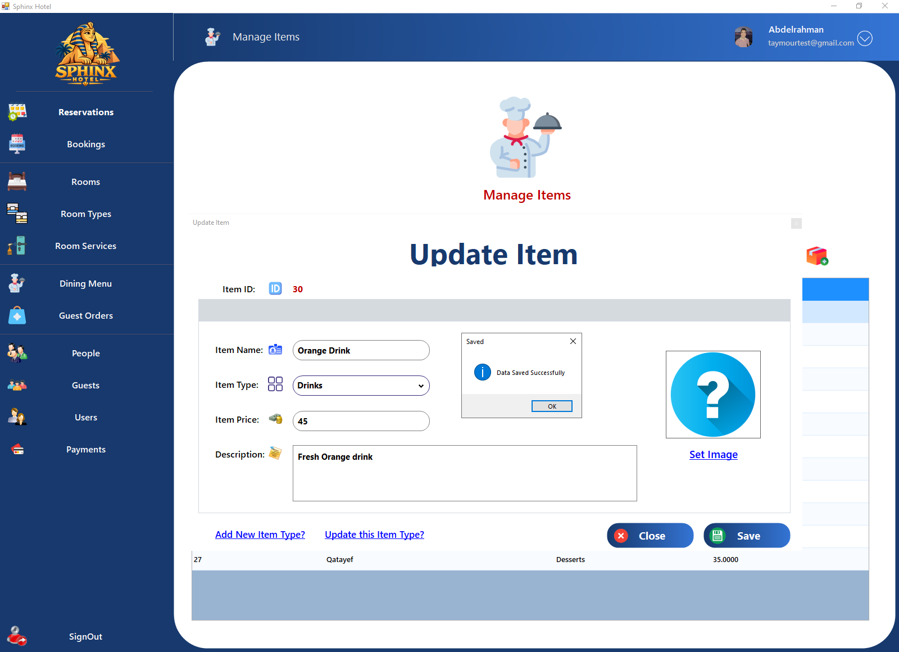

### 👥 Guests & Users

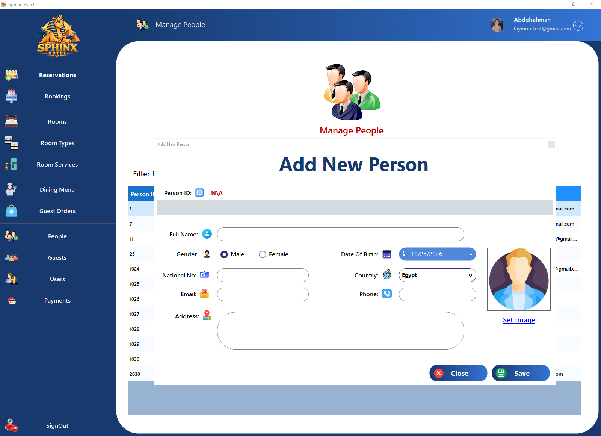
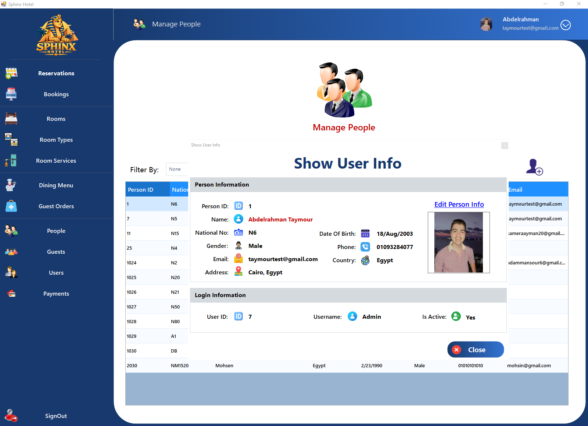

</div>

## 🏗️ Architecture

Sphinx Hotel follows a clean **3-tier architecture**, separating concerns across presentation, business logic, and data access for maintainability and testability:

```
┌─────────────────────────────┐
│     Presentation Layer      │   Hotel (WinForms UI)
│   Forms, user interaction   │
└──────────────┬──────────────┘
               │
┌──────────────▼───────────────┐
│      Business Logic Layer    │   Hotel_Business
│  Rules, validation, workflow │
└──────────────┬───────────────┘
               │
┌──────────────▼───────────────┐
│       Data Access Layer      │   Hotel_DataAccess
│   ADO.NET + Stored Procedures│
└──────────────┬───────────────┘
               │
┌──────────────▼───────────────┐
│      Microsoft SQL Server    │   Database
└──────────────────────────────┘
```

- **Presentation (`Hotel`)** — Windows Forms UI where staff interact with the system (login, reservations, check-in/out, orders, room and user management).
- **Business Logic (`Hotel_Business`)** — Encapsulates domain rules, validation, and object models (OOP-driven design) between the UI and the database.
- **Data Access (`Hotel_DataAccess`)** — Handles all database communication through **ADO.NET**, calling **T-SQL stored procedures** for CRUD operations.
- **Database** — A Microsoft **SQL Server** database with stored procedures powering every data operation, keeping business logic out of the UI and queries out of the application code.

## 🧰 Tech Stack

| Layer          | Technology                                                  |
| -------------- | ----------------------------------------------------------- |
| Language       | C#                                                          |
| Framework      | .NET Framework                                              |
| UI             | Windows Forms (WinForms)                                    |
| Data Access    | ADO.NET                                                     |
| Database       | Microsoft SQL Server                                        |
| Database Logic | T-SQL Stored Procedures                                     |
| Architecture   | 3-Tier Architecture (Presentation / Business / Data Access) |
| Paradigm       | Object-Oriented Programming (OOP)                           |

## 📁 Project Structure

```
Sphinx-Hotel/
├── Database/           # SQL Server database scripts & stored procedures
├── Hotel/              # Presentation layer – WinForms UI
├── Hotel_Business/     # Business logic layer – rules & domain models
├── Hotel_DataAccess/   # Data access layer – ADO.NET + stored procedure calls
└── README.md
```

## 🚀 Getting Started

### Prerequisites

- **Windows OS**
- **Visual Studio** (2019 or later recommended)
- **.NET Framework** (matching the solution's target version)
- **Microsoft SQL Server** (Express or higher) + **SQL Server Management Studio (SSMS)**

### Installation

1. **Clone the repository**

   ```bash
   git clone https://github.com/AbdelrahmanTaymour/Sphinx-Hotel.git
   cd Sphinx-Hotel
   ```

2. **Set up the database**
   - Open **SSMS** and connect to your local SQL Server instance.
   - Run the scripts in the [`Database`](./Database) folder to create the database, tables, and stored procedures.

3. **Configure the connection string**
   - Open the solution in Visual Studio.
   - Update the connection string in the data access layer (`Hotel_DataAccess`) to point to your local SQL Server instance.

4. **Build and run**
   - Open `Sphinx-Hotel.sln` in Visual Studio.
   - Set `Hotel` as the startup project.
   - Build the solution and run it (`F5`).

5. **Log in**
   - Use the credentials seeded by the database scripts.
     ```
     Username: admin
     Password: admin
     ```

## 🤝 Contributing

Contributions, issues, and feature requests are welcome!
Feel free to check the [issues page](https://github.com/AbdelrahmanTaymour/Sphinx-Hotel/issues) or open a pull request.

1. Fork the project
2. Create your feature branch (`git checkout -b feature/amazing-feature`)
3. Commit your changes (`git commit -m 'Add some amazing feature'`)
4. Push to the branch (`git push origin feature/amazing-feature`)
5. Open a Pull Request

## 📄 License

This project is licensed under the **MIT License** — feel free to use, modify, and distribute it.

## 👤 Author

**Abdelrahman Taymour**

[](https://github.com/AbdelrahmanTaymour)

---

<div align="center">

If you found this project useful or interesting, consider giving it a ⭐!

</div>
